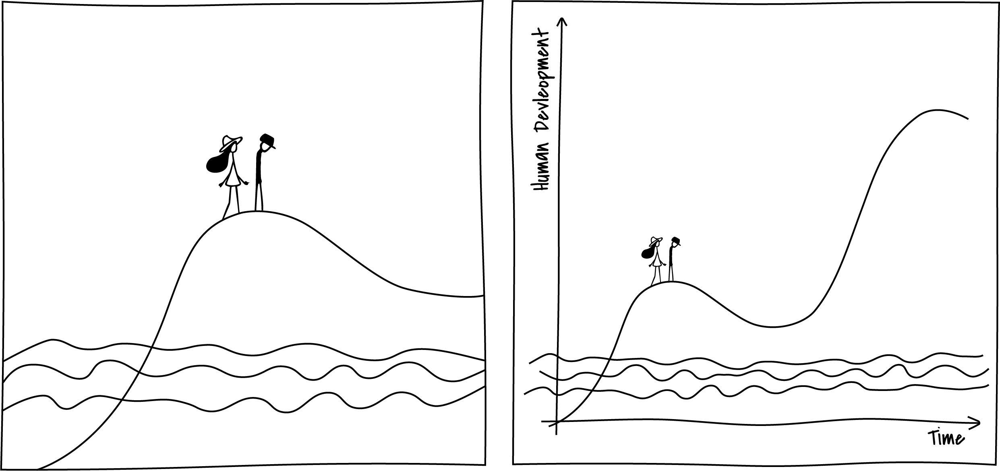

# Progress

As I'm getting older a lot of my social circles are becoming ever more
conservative.  The focus shifts from building with ambition to fiercly
protecting what one has achieved.  Shifting the mind on protectionism
makes one consider all that can cause damage.  It puts the [focus on the
negative](/2023/3/20/lessons-from-a-pessimist/), it makes those
negative thoughts feel much more significant than they are and one dwells
on the past, instead of envisioning of what opportunity might lie ahead.

Yet, when we look back at history, it becomes clear that progress and
fresh ideas tend to prevail over time.  Not every new idea will succeed,
but the overall trend is undeniable.

I believe that every day presents us with a choice: to step forward with
courage and optimism or to cling to the status quo, even as it becomes
increasingly untenable.  Embracing new ideas carries inherent risks,
but so does the refusal to explore them.

Right now we find ourselves slowly sliding down from our local maximum and
some people try to pull you back up to where we were standing.  On the
other hand if you dare to run you will find a bigger and more impressive
hill to scale.  One that offers a better vantage point and when water
rises undoubtedly the better place to be.

In today's political environment, the rhetoric is dominated by a yearning
for the past.  Some politicians will promote a return to fossil fuels and
conservative social norms.  They play into your fears of others and
promote individualism at cost of the collective.  The will uphold every
bad news as a reason to fortify borders and strengthen nation-states.

But as time marches on, future generations will likely look back at these
regressive inclinations and wonder how we could have been so
short-sighted.
